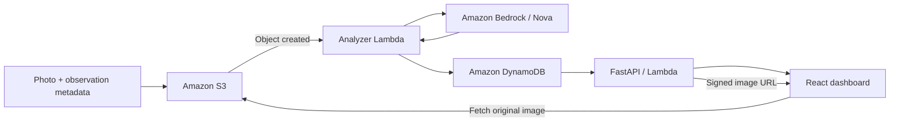

# GridGuardian

**Infrastructure intelligence for Puerto Rico — built for HackRPI 2026.**

GridGuardian turns photos of electrical infrastructure into visual assessments
that can be explored on a map. It brings image analysis, inspection findings,
and geographic context into one dashboard to help identify observations that
may need attention.

## What it does

- Analyzes uploaded images with Amazon Nova through Amazon Bedrock.
- Classifies observations as **Healthy**, **Maintenance**, **Damaged**, or
  **Unassessed**, with severity, detected issues, and a recommended action.
- Shows ZIP-scoped analytics, daily activity, and inspection reports.
- Maps observations with GPS coordinates and offers light and satellite views.
- Opens original inspection images through short-lived signed S3 links.
- Filters by classification, severity, dates, flight, and pole; exports matching
  reports to CSV.

The current prototype accepts image uploads; drone flight control and automated
image capture are outside this repository. Assessments are preliminary and
require qualified inspection. Dashboard totals count image observations, not
unique poles or a complete grid inventory.

## How it works



Uploads carry a ZIP code and optional capture time, GPS coordinates, flight ID,
and pole ID. The analyzer validates the model response and writes a structured
report to DynamoDB. Retry records prevent completed images from being analyzed
again. Failed asynchronous invocations are sent to an SQS failure queue.

The read API provides reports, analytics, GeoJSON, and image links. The browser
uses the API directly; it does not need AWS credentials. Images remain private
in S3, and signed links expire after five minutes.

## Technology

| Layer | Stack |
| --- | --- |
| Dashboard | React, TypeScript, Vite, Leaflet, Lucide |
| API | Python 3.11, FastAPI, Mangum, boto3 |
| Image analysis | Python 3.12 Lambda, Amazon Bedrock, Amazon Nova |
| Storage and operations | S3, DynamoDB, ECR, CloudWatch, SQS |
| Infrastructure and releases | Terraform, GitHub Actions, GitHub OIDC |
| Frontend hosting configuration | Vercel |

## Repository guide

| Path | Purpose |
| --- | --- |
| [`src/GridGuardianUI/GridGuardianUI/`](src/GridGuardianUI/GridGuardianUI/README.md) | Dashboard, local setup, and Vercel configuration |
| [`src/GridGuardianAPI/`](src/GridGuardianAPI/README.md) | Read API, endpoint contract, tests, and API image build |
| [`lambda/`](lambda/) | S3-triggered analyzer, model prompt, and worker tests |
| [`scripts/`](scripts/) | Single-image uploader and image validation tests |
| [`src/GridGuardianAPI/images/`](src/GridGuardianAPI/images/README.md) | Sample photos and synthetic batch uploader |
| [`terraform/`](terraform/README.md) | Shared AWS infrastructure and state guidance |
| [`docker/GridGuardian.Dockerfile`](docker/GridGuardian.Dockerfile) | API Lambda image |
| [`.github/workflows/`](.github/workflows/) | API release and analyzer image publishing workflows |

`main` is the integrated project branch. `api`, `ui`, and `aws-infra` contain
component development work; use the consolidated Terraform configuration on
`main` when managing infrastructure.

## Run locally

You need Node.js 22.x, Python 3.11 for the API, and `uv`.
AWS-backed requests also need an authorized AWS profile and access to the
existing project resources. Starting the dashboard and API locally does not
start the S3 analysis pipeline.

### API

From the repository root:

```sh
cd src/GridGuardianAPI
uv sync --python 3.11
AWS_PROFILE=YOUR_AWS_PROFILE AWS_DEFAULT_REGION=us-east-1 \
  uv run uvicorn main:app --reload --port 8000
```

Open `http://localhost:8000/docs` for interactive API documentation.
`/health` checks the process; data routes use DynamoDB. See the
[API README](src/GridGuardianAPI/README.md) for environment variables and filters.

### Dashboard

In another terminal, from the repository root:

```sh
cd src/GridGuardianUI/GridGuardianUI
npm ci
cp .env.example .env.local
```

Set `VITE_API_BASE_URL=http://localhost:8000` in `.env.local` to use the local API,
or supply your deployed API base URL. Then run:

```sh
npm run dev
```

Open the URL printed by Vite. The dashboard starts with ZIP `00901`; it needs
existing reports for the selected ZIP to display observations. Map tiles need
internet access. Vite reads this public configuration at startup or build time.

### Upload an inspection photo

From the repository root, using Python 3.12 and an authorized AWS profile:

```sh
python3.12 -m venv .venv
.venv/bin/python -m pip install -r scripts/requirements.txt
.venv/bin/python scripts/upload_image.py \
  --image /path/to/photo.jpeg --zipcode 00901 --dry-run
```

Remove `--dry-run` and add `--profile YOUR_AWS_PROFILE` to upload. Optional
`--latitude`, `--longitude`, `--timestamp`, `--flight-id`, and `--pole-id` flags
carry observation metadata. Supply both coordinates together. JPEG, PNG, and
WebP images are supported, up to 3.75 MiB and 8000 pixels per dimension.

With the deployed S3 event integration enabled, uploads start asynchronous
analysis. Upload success alone does not confirm that a report is ready.
The [batch uploader](src/GridGuardianAPI/images/README.md) can generate demo
observations with synthetic Puerto Rico coordinates and timestamps; these
are not the photos' actual capture locations or times.

## Verification

Run each command from the repository root:

```sh
(cd src/GridGuardianAPI && uv run python -m unittest discover -v)
(cd src/GridGuardianUI/GridGuardianUI && npm run build && npm run lint)
.venv/bin/python -m unittest discover -s lambda -v
.venv/bin/python -m unittest discover -s scripts -v
terraform -chdir=terraform fmt -check
terraform -chdir=terraform init -backend=false -lockfile=readonly
terraform -chdir=terraform validate
```

The worker and upload tests use the root Python environment created above.
Unit tests use mocked AWS services; they do not establish deployed connectivity.
Terraform validation does not apply infrastructure changes.

## Deployment

The [infrastructure README](terraform/README.md) covers the shared Terraform
state, existing-resource imports, image inputs, and plan review.

- **API:** matching pushes to `main` or `api` build an image, publish to ECR, and
  update `GridGuardianAPI` when the function exists. Terraform owns infrastructure;
  GitHub Actions owns subsequent API image releases.
- **Analyzer:** matching pushes to `main` or `aws-infra` publish an image to ECR.
  Set the resulting `image_tag` in Terraform to release the worker.
- **Dashboard:** import the repository into Vercel with production branch `main`
  and root directory `src/GridGuardianUI/GridGuardianUI`. Configure
  `VITE_API_BASE_URL` before building. See the [UI README](src/GridGuardianUI/GridGuardianUI/README.md).

The checked-in Terraform does not provision the public API function URL or an
HTTP gateway. The deployed API URL must be configured separately and must allow
the dashboard origin through CORS. The prototype's read API has no authentication.
